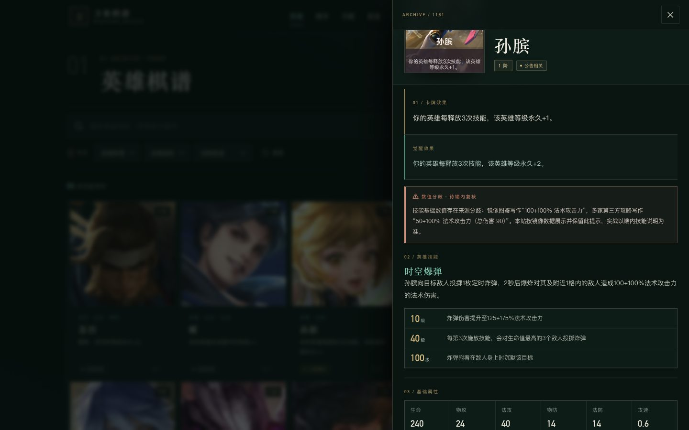
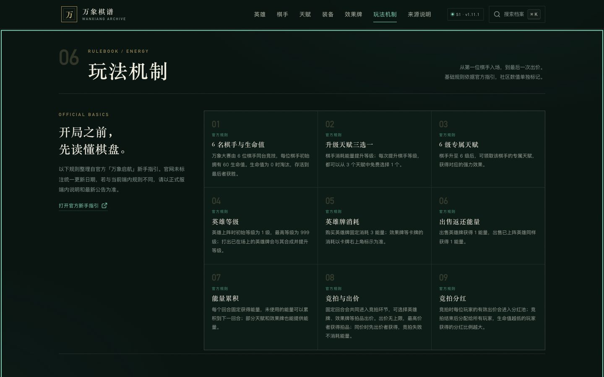
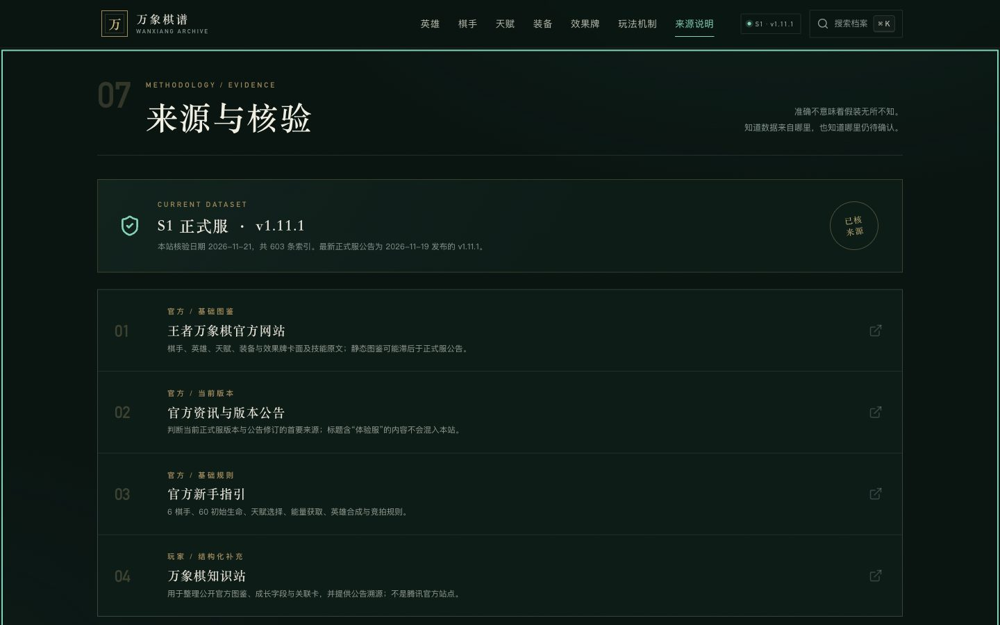
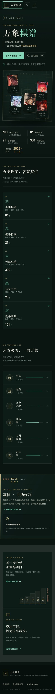

# 万象棋谱 · 王者万象棋资料库

> **在线访问**：<https://wanxiangqi-compendium.netlify.app> · **源码仓库**：<https://github.com/e69d8e/wanxiangqi-compendium>
> 正式服 S1 · v1.11.1 · 资料核验至 2026-11-21 · 603 条结构化条目
> [](https://github.com/e69d8e/wanxiangqi-compendium/actions/workflows/deploy.yml)

一个可离线部署、可全文检索的《王者万象棋》资料站：英雄、棋手、天赋、装备、效果牌、玩法机制与版本公告修订，全部结构化整理，并逐条标注来源与核验状态。

  

## 内容

- **603 条资料**：英雄 86 · 装备 95（当前 77）· 天赋 300（当前 299）· 效果牌 101（当前 98）· 棋手 21。
- **详情抽屉**：卡牌效果 / 觉醒效果 / 英雄技能与 10·40·100 级强化 / 基础属性 / 等级成长 / 棋手技能·秘技·专属 / 关联卡 / 获取方式 / 来源链接。
- **全站搜索**（⌘K / Ctrl K，↑↓ 选择 / ↵ 打开 / ESC 关闭）、分类维度筛选、卡片与紧凑列表双视图、URL 同步、分页。
- **玩法机制页**：9 条核心规则、18 条关键词释义、棋手升级能量阶梯与计算器、最新版本公告对照。
- **来源与核验页**：证据分层、数据边界、各分类实际收录数。
- **公告修订层**：官方公告“调整后”原文直接覆盖卡面滞后文本，抽屉内可看到「修订公告 / 相关公告」标识。

数据口径、逐条公告比对与未决项见 [VERIFICATION.md](./VERIFICATION.md)；字段与管线细节见 [DATA_NOTES.md](./DATA_NOTES.md)；视觉设计见 [DESIGN.md](./DESIGN.md)。

## 界面一览

| | |
| --- | --- |
|  |  |
| 首页：棋阵、603 条统计、阵营分布、v1.11.1 校勘 | 英雄棋谱：搜索 + 阵营/品阶/状态筛选 + 双视图 |
|  |  |
| 详情抽屉：卡牌效果/觉醒/技能节点/属性/成长 | 无法裁定的数值分歧会显式提示，而不是装作确定 |
|  |  |
| 玩法机制：核心规则、能量阶梯与计算器 | 来源与核验：证据分层与数据边界 |

移动端（390×844）逐页实测无横向溢出：

## 技术栈

Vite 6 + React 19 + TypeScript，hash 路由，无后端、无运行时网络请求，全部数据与图片随构建产物发布。样式为手写 CSS（深墨绿 / 青玉 / 鎏金），含响应式断点、`prefers-reduced-motion`、键盘焦点与打印样式。

## 本地开发

```bash
npm install
npm run dev      # http://localhost:5173
```

## 构建

```bash
npm run build    # 产物输出到 dist/
npm run preview  # 本地预览构建产物
```

> macOS 提示：若 `rollup` 原生模块报 `different Team IDs` 的 `dlopen` 错误，是当前 Node 运行时的代码签名与预编译二进制不一致所致，换用 Homebrew 的 Node（adhoc 签名）即可正常构建：
>
> ```bash
> export PATH="/opt/homebrew/bin:$PATH"
> npm run build
> ```

## 持续部署（push 即上线）

仓库已通过 **GitHub Actions** 与 Netlify 站点连通：推送到 `main` 或手动触发 `.github/workflows/deploy.yml` 时，CI 依次执行 `npm ci` → `npm test`（13 条断言）→ `npm run validate:data` → `npm run build`，再用 Netlify CLI 做生产部署；任何一步失败都不会覆盖线上版本。

需要两个仓库机密（已配置）：

| Secret | 说明 |
| --- | --- |
| `NETLIFY_AUTH_TOKEN` | Netlify 个人访问令牌，用于 CLI 认证 |
| `NETLIFY_SITE_ID` | 站点 ID `20d9a79f-37e0-4ac1-a58d-e511d7486c7f` |

> 说明：Netlify 开放 API 没有“绑定 Git 仓库”的方法（只有 `unlinkSiteRepo`），原生 Git 集成必须走 GitHub App 的 OAuth 授权流程；因此这里用 CLI + Actions 完成等效的持续部署，效果是推送即上线，Netlify 后台的 Deploys 列表会显示由 API/CLI 触发的生产部署。

## 每周自动更新

每周六 10:00（Asia/Shanghai），一个 DSH 定时任务会新建会话执行完整周更：抓取官网目录/棋手与官方公告 → 对比本地基线 → 有新内容时重建数据、跑测试与校验 → 推送 `main` → 等待 GitHub Actions 部署 → 轮询线上资源哈希确认 Netlify 已更新。没有内容变化时不产生空提交。

```bash
npm run sync:live          # 抓取并对比，只读
npm run sync:live:write    # 有变化时写入 .research
npm run check:netlify      # 对比本地 dist 与线上 /assets，默认最多等 300 秒
```

完整流程、需要同步的硬编码口径、公告核对规则与失败处理见 [docs/AUTOMATION.md](./docs/AUTOMATION.md)。

## 部署到 Netlify

线上站点：<https://wanxiangqi-compendium.netlify.app>（Netlify 项目 `wanxiangqi-compendium`，站点 ID `20d9a79f-37e0-4ac1-a58d-e511d7486c7f`），当前部署由 Netlify CLI 完成：

```bash
npm install -g netlify-cli
netlify login                 # 或 NETLIFY_AUTH_TOKEN=... 免交互
netlify link                  # 关联已有站点 wanxiangqi-compendium
netlify deploy --prod --dir=dist --message "..."   # 生产部署
# 或者让 Netlify 远程构建：netlify deploy --build --prod
```

仓库已包含 `netlify.toml`，无需额外配置：

- 构建命令：`npm run build`
- 发布目录：`dist`
- 已配置 SPA 重写（`/* → /index.html`，200）、`/assets/*` 与 `/images/*` 缓存头，以及基础安全响应头。
- Node 版本锁定为 22。

方式一：把仓库推到 Git 平台（GitHub/GitLab），在 Netlify 选择 “Import from Git”，保留默认读取 `netlify.toml` 即可。

方式二：本地构建后，把 `dist/` 目录拖到 Netlify Drop 页面直接发布。

## 测试

```bash
npm test              # 13 条断言：数据完整性、公告修订层、数值分歧提示、机制数据、hash 路由
npm run validate:data # 管线侧校验：数量口径、id 唯一、603 张图片、7 条公告修订、禁用词
```

两层校验互补：`npm test` 面向仓库内已生成的数据与纯函数，`validate:data` 面向原始抓取与构建过程。

## 数据更新

```bash
node scripts/build-data.mjs      # 由 .research 原始资料重建 src/data/*.json（含公告修订覆盖与断言）
npm run validate:data            # 校验数量口径、id 唯一、图片齐全、公告修订文案与禁用词
node scripts/download-images.mjs # 同步本地图片到 public/images/
```

## 目录结构

```
src/
  components/   首页、目录、详情抽屉、全站搜索、机制页、来源页等
  data/         构建产出的 JSON 与 mechanics.ts
  lib/          hash 路由与目录筛选工具
  styles.css    全部样式
scripts/        build-data / download-images / validate-data / sync-live / check-netlify
public/images/  本地化图片（按 kind/id 命名）
```

## 免责声明

本项目为非官方粉丝向资料整理，与腾讯及《王者万象棋》官方无关；卡面与技能原文版权归原权利方所有。站内数据以正式服 S1、v1.11.1 为基线，公告修订优先于静态卡面；社区来源的升级能量等数值已明确标注「待端内复核」。发现错漏欢迎对照 [VERIFICATION.md](./VERIFICATION.md) 的复现方式提交修正。
